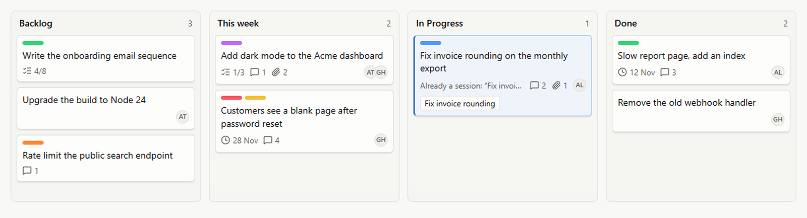

# prifly-ext-trello

A [prifly](https://github.com/jimmy927/prifly) extension that puts your Trello
board into the window. **From a Trello card…**, beside New session, lays the
board out in its columns; the card you pick becomes a session that already
knows the whole ticket — description, comments, checklists, and every attached
picture saved to disk and pointed at. The card then rides along on that
session's banner: click it to open it in Trello, or use its menu to move it to
another column when the work moves.



*The board as prifly shows it, drawn with invented cards. A card that already has a session is tinted.*

## Install

Needs a prifly with extension **settings**, **state** and **secrets**. When
one of the three is missing the list shows a single row, "Update prifly to use
this extension", and nothing else runs: no refresh, no Trello calls.

In prifly: status bar → the puzzle icon → Install from
`https://github.com/jimmy927/prifly-ext-trello`, then tick it to enable it. Or
clone this repository into `~/.local/share/prifly/extensions/`.

There is nothing to configure and no Trello app to make. Open **From a Trello
card…** and follow the two rows it shows:

1. **Open the Trello login page** — your browser opens Trello's own approval
   page. Sign in however you normally do (Google, Microsoft, Atlassian); prifly
   never sees a password.
2. **Paste the token Trello shows you** — one paste, once. It is checked
   against Trello there and then, and kept in the extension's own sealed
   secrets (`api.secrets`): there is no card to confirm, and the token moves
   with prifly's data.

Then pick which of your boards to show. That is the whole setup. The board can
be changed later from the same list ("Switch board…"), as can logging out.

Trello wants a **token** (you) and an **app key** (the app asking) on every
call. The app key is prifly's own and is public by design: it reads nothing on
its own.

The plain configuration is a set of settings in prifly's **Extensions** dialog
(Trello board):

| Setting | What it is |
| --- | --- |
| Folder a card's session works in (`cwd`) | Typed as your system writes it, e.g. `/home/you/src/app` or `C:\Users\you\src\app`; taken as typed. Empty: you pick it in the New session form as usual. |
| Columns that mean the work is over (`done`) | Comma-separated, e.g. `Done, Released`; drawn in the quiet colour. |
| Move the card to this column when a session starts (`inProgress`) | Any case; empty leaves cards where they are. |
| Refresh the board every (`refreshSeconds`) | At least 15. A change takes effect at once. |

These are stored in prifly's database, so they move with prifly's data (for
instance to a native Windows host). On Windows, set the folder once: a Linux
path means nothing there.

The board you chose, each session's cards and the other things the extension
remembers live in prifly's database (`api.state`), so `prifly-move` carries them
to another machine. Sessions never get the token: they read Trello through the
extension's `trello_*` tools, which use the login inside the extension (kept in `api.secrets`). The downloaded `cards/` are ignored by git: nothing
about your account or your board is ever committed.

Earlier versions filed the token in prifly's vault as the entry `trello`. The
manifest still lists `"vault": ["trello"]` (JSON has no comments) for that
migration only: on start, a login found there is copied into `api.secrets` and
the entry forgotten. If the vault still holds one afterwards (an entry you made
yourself), you are told once that it can be removed in the Vault dialog; it is
never copied again after you log out.

Updating from a version that kept its login or board choice in files in this
folder: those files are no longer read. Log in once more and pick your board
again; the old files can be deleted.

## The board

*From a Trello card…* opens your board nearly the size of the window, laid out
the way a board is laid out: a column per list, cards stacked in them, labels
as coloured stripes, and the small marks that say how much is on a card — due
date, checklist, comments, attachments — with the members' initials on the
right. Drawn in prifly's own ink: the arrangement is Trello's, the look is not.

In it you can

- **read a card** — click it, and the description, the checklists, the
  conversation and the attached pictures open over the board;
- **move a card** — drag it into another column, or use its right-click menu;
- **ignore a card** — "Never start a session from this" in its right-click
  menu takes a card that is not software work off the board for good. "Show
  ignored cards" at the end of the board lists them, and "Show on the board
  again" in their menu brings one back. Kept in prifly's database;
- **start a session from a card** — the button in the card, its right-click
  menu, or a double-click on it. The card moves to the `inProgress` column
  (In Progress) as the session starts;
- **filter** — by title, description, label, member or card id. The columns
  stay put while the cards thin out, so the board still reads as your board.

## What it brings

- **A launcher** — your board, and the chosen card as a session's first prompt
  (`index.ts`). Attachments are downloaded to `cards/<card>/`; the prompt says
  where they are and to look at them.
- **A chip on the session** — which column the card is in, who is on it, when
  it is due, how much has been said on it. It links to the card, and its menu
  moves the card to any other column on the board.
- **A summary on the card** — when a session is archived, prifly's archive
  dialog names the column the card is in, offers the other columns to move it
  to, and a box "Post a summary of this session on the card". Ticked, the
  session gets one more turn: it writes what was done for the people on the
  board and posts it as a comment with pictures of the change (its mockups,
  its screenshots) through the `trello_post_summary` tool, and prifly archives
  it once that turn is over. The chip's menu has the same summary for any
  time. Two settings in the Extensions dialog: whether the box starts ticked
  (`summaryOnArchive`, on), and the column picked first (`archiveColumn`,
  e.g. Done; empty leaves the card where it is). Needs a prifly with
  "archive-follow-ups"; an older one still offers the moves and the menu item.
- **The active cards, to read** — the `trello_cards` tool lists the board's
  active cards as JSON (`id`, `name`, `column`, `labels`, `url`,
  `lastActivity`, `sessionId`), at most 30: those in an active column, plus
  every card a live session carries, wherever it sits (those first). It only
  reads — it never moves a card or asks the reader anything — so another
  extension can call it through prifly's `api.tools.read`. An optional
  `columns` (array of words) replaces which columns are active; by default
  the `activeColumns` setting does: any column whose name contains
  "progress", "denna vecka" or "this week", in any case. Not logged in, it
  answers in plain text.
- **Read tools for every session**, all read-only and using the extension's own
  login, so no token reaches the session: `trello_search` (full-text search,
  open boards first, `limit`), `trello_card` (one card whole: column, labels,
  members, description, comments oldest first, checklists, attachment list;
  takes a link, short id or long id), `trello_boards` (open boards, `all` for
  archived too) and `trello_attachments` (downloads a card's Trello-hosted
  attachments to a folder, the session's scratchpad by default, and answers
  with the file paths; links to other sites are listed, not fetched). Not
  logged in, each answers in one plain line.
- **Create a card** — `trello_create_card` (`board` as id, name or link, default
  the chosen board; `column` by name, any case; `title`; optional `description`
  in Markdown; `position` "bottom" or "top") makes a card as the reader. The
  reader sees a confirm card with board, column, title and description first;
  cancelled, nothing is created ("Not done: you cancelled"). An unknown board
  or column is refused with the valid ones. It answers with the card's URL
  and id.
- **Attach files** — `trello_attach_file` (`card` as link, short id or long
  id; `files` as absolute local paths of any type, Windows `C:\...` or WSL)
  uploads them to the card as the reader. The reader sees a confirm card with
  the card's name and each file's name and size first; cancelled, nothing is
  uploaded ("Not done: you cancelled"). A missing file or unknown card is
  refused before anything is asked or uploaded. It answers with each
  attachment's name and URL.
- **A Claude Code skill** — `skills/trello`, for a terminal outside prifly:
  search cards, read one whole, download its attachments with `trello.py`.
  Inside prifly the tools above are used instead. The
  repository is also a Claude Code plugin and its own marketplace, so terminal
  sessions can have it too; there, set `TRELLO_TOKEN` to your Trello token:

      claude plugin marketplace add jimmy927/prifly-ext-trello
      claude plugin install trello@prifly-ext-trello

- **Instructions** — `prompt.md`, added to every session prifly starts: read
  the pictures, leave moving the card to the reader, never ask for a token.

## How a card finds its session

prifly hands the extension the id of the session a launch became, and the pair
is kept in prifly's database (`api.state`) here. A card therefore belongs to the session that was
started from it — nothing else claims a card, and an existing session cannot be
adopted by one.

A card is normally started once, so a card that already has a session is
tinted on the board (prifly's `started` on a choice), and picking it asks first: type "again"
(or anything) into the row that appears to start a second session anyway. The
Start button of a card opened for reading only says which session it already
is. Once that session is deleted, the card is plain again.

## Writing an extension

An extension is a folder with a `prifly-extension.json` manifest;
`prifly-api.ts` here is prifly's whole contract, copied so this repository
type-checks on its own. This one uses all of it:

```json
{ "id": "trello", "name": "Trello board", "main": "index.ts",
  "prompt": "prompt.md",
  "launch": [{ "id": "card", "label": "From a Trello card…", "icon": "link" }] }
```

- **`main`** exports `activate(api)` — and, for a launcher, `choices(id, query)`,
  `launch(id, key, input)`, `launched(id, key, sessionId)` and
  `action(key, actionId)`.
- A row may **ask for something** (`input` on a choice) and a launch may bring
  **no prompt at all**, which leaves the chooser open and lists again. That is
  how this extension has a login and a board picker without a settings screen:
  see `setup.ts`.
- **`prompt`** is added to the system prompt of every session prifly starts.
- **`.claude-plugin/plugin.json`** in the same folder makes it a Claude Code
  plugin too; prifly passes the folder to its sessions with `--plugin-dir`.

Extensions run inside prifly's host with its rights, which is why prifly starts
none until you enable one.

## License and contributing

Source-available under the Functional Source License 1.1 with an Apache 2.0 future license (`LICENSE.md`): use it, change it and fix it freely, but not to offer a competing product. Each version becomes Apache 2.0 two years after its release.

Pull requests are welcome. Before one can be merged, its author signs the contributor agreement (`CLA.md`), which assigns the copyright in the contribution to The Startup Factory AB; the CLA bot asks for it on the pull request.
